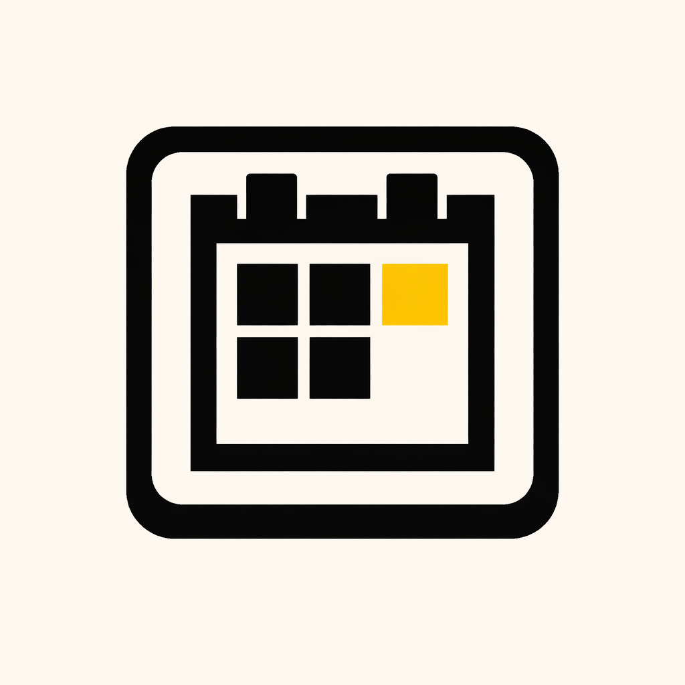

<p align="center">
  
</p>

<h1 align="center">Seu Calendário Acadêmico</h1>

<p align="center"><b>Prazos, provas e trabalhos da sua turma num calendário só, acessível pelo celular e alimentado pela própria sala.</b></p>

<p align="center">
  <a href="https://listadeatividades.davixs.com.br/"><b>Acessar o app</b></a> ·
  <a href="#funcionalidades">Funcionalidades</a> ·
  <a href="#tecnologias">Tecnologias</a> ·
  <a href="#rodando-localmente">Rodando localmente</a>
</p>

<p align="center">
  <a href="https://listadeatividades.davixs.com.br/"></a>
</p>

<p align="center">
  
  
  
  
  
  
</p>

Alunos convivem com prazos e provas espalhados entre WhatsApp, Teams e avisos informais. O **Seu Calendário
Acadêmico** centraliza tudo por curso, turno, semestre e sala: a consulta pública é rápida, e a turma
registra novas atividades que o responsável da sala modera.

## Funcionalidades

- **Consulta pública sem login**: navegue por curso, turno e semestre e veja o calendário da sua sala.
- **Calendário mensal**: visão consolidada das entregas, com detalhe diário.
- **Filtros** por matéria e tipo de atividade.
- **Cadastro colaborativo**: qualquer aluno pode registrar uma atividade; o líder da sala modera.
- **Lembretes por e-mail** antes dos prazos.
- **Painel do líder de sala** e **painel master admin** para operação e visibilidade global.

## Tecnologias

- **Frontend:** React 19, Vite, React Router, Tailwind CSS (em [`frontend/`](frontend)).
- **Backend:** Spring Boot 4 (Java), Spring Security, Spring Data JPA, Flyway, Redis e PostgreSQL (em [`src/`](src)).
- **Infra:** Docker Compose ([`docker-compose.yaml`](docker-compose.yaml)) e deploy com Fly.io ([`fly.toml`](fly.toml)).

Escopo do produto e personas: [`prd.md`](prd.md).

## Rodando localmente

Pré-requisitos: Node.js, Java e Docker (para Redis/PostgreSQL via `docker-compose.yaml`).

```bash
# backend
./mvnw spring-boot:run

# frontend (em outro terminal)
cd frontend
npm install
npm run dev
```

Para ver o que mais existe no repositório (scripts de seed, coleções de API em `BrunoTestAPI/`, planos em
`docs/`), use a árvore do projeto.

